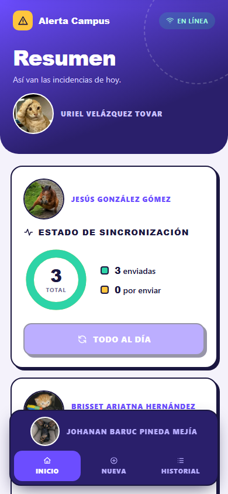
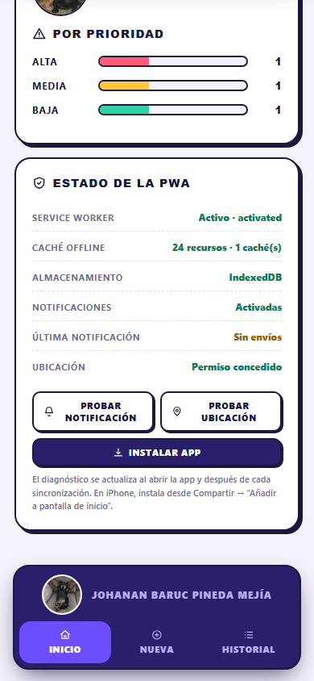
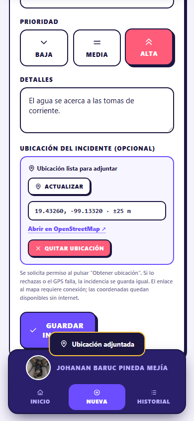
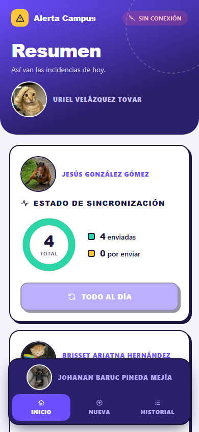

# Alerta Campus — PWA de registro de incidencias

PWA **offline-first** para reportar incidencias del campus desde el teléfono. Guarda primero
en el dispositivo, sincroniza cuando hay red, adjunta la ubicación del incidente y avisa con
una notificación local cuando el reporte es de prioridad Alta.



---

## Características

- **Offline-first:** IndexedDB con respaldo en localStorage; la app abre y permite crear,
  editar, buscar y eliminar incidencias sin conexión.
- **Service Worker** con cuatro estrategias: Network First (navegación), Stale-While-Revalidate
  (CSS/JS), Cache First (imágenes) y Network Only (API).
- **Precache** del shell, iconos e imágenes; versionado y limpieza automática de cachés.
- **Actualización controlada:** aviso de nueva versión y activación por decisión del usuario.
- **Notificaciones locales** con `ServiceWorkerRegistration.showNotification()`; permiso solo
  por gesto y disparador en incidencias de prioridad Alta.
- **Geolocalización opcional** con manejo de permiso denegado, timeout, GPS no disponible y
  contexto no seguro.
- **PWA instalable:** manifest, iconos 192/512/maskable, shortcuts y modo standalone.
- **Diagnóstico interno:** estado del SW, caché, almacenamiento y permisos en la propia UI.
- **Sin dependencias de producción:** JavaScript Vanilla + Node.js.

| Móvil | Diagnóstico PWA |
|---|---|
|  |  |

| Geolocalización | Modo offline |
|---|---|
|  |  |

---

## Inicio rápido

Requisitos: **Node.js 18+**. El Service Worker requiere `http://localhost` o HTTPS.

```powershell
# 1. (Opcional) datos de demostración
Copy-Item db.example.json db.json

# 2. Servidor local
npm start
# o: node server.js

# 3. Abrir
# http://localhost:3000
```

> No abras `index.html` con doble clic: `file://` no permite Service Worker ni geolocalización.

### Scripts

| Comando | Descripción |
|---|---|
| `npm start` | Inicia el servidor en `http://localhost:3000`. |
| `npm run dev` | Igual que `start`. |
| `npm run test:e2e` | Ejecuta las 15 pruebas E2E con Edge headless y genera capturas. |
| `npm run icons` | Regenera los iconos PNG (requiere Python + Pillow). |

### Variables de entorno del servidor

| Variable | Por defecto | Uso |
|---|---|---|
| `PORT` | `3000` | Puerto HTTP. |
| `DB_FILE` | `./db.json` | Ruta del archivo de datos. |

```powershell
$env:PORT=3100; $env:DB_FILE="tests\.tmp\db.json"; node server.js
```

---

## Estructura

```text
.
├── index.html              # Shell y vistas
├── offline.html            # Fallback sin conexión
├── manifest.json           # Instalación PWA
├── sw.js                   # Service Worker
├── server.js               # Servidor Node + API REST
├── css/styles.css          # Diseño responsive
├── js/
│   ├── app.js              # Orquestador de UI
│   ├── db.js               # IndexedDB + respaldo
│   ├── api.js              # Cola y sincronización
│   ├── ui.js               # Utilidades
│   ├── geolocation.js      # Característica física
│   ├── notifications.js    # Notificaciones locales
│   └── pwa.js              # Registro/actualización del SW
├── icons/                  # Iconos PNG/SVG
├── docs/                   # Entregables y evidencias
├── tests/                  # E2E + reporte
└── tools/                  # Generación de iconos
```

---

## API REST

| Método | Ruta | Descripción |
|---|---|---|
| `GET` | `/api/incidencias` | Lista todas. |
| `GET` | `/api/incidencias/:id` | Obtiene una. |
| `POST` | `/api/incidencias` | Crea (idempotente por `id`). |
| `PUT` | `/api/incidencias/:id` | Actualiza si `updated` es reciente. |
| `DELETE` | `/api/incidencias/:id` | Elimina (idempotente). |
| `GET` | `/api/health` | Estado del servicio. |

La app nunca depende de la API para guardar: escribe en IndexedDB y sincroniza después.

---

## Pruebas

```powershell
node tests/e2e.mjs
```

El arnés usa Edge headless + Chrome DevTools Protocol, levanta un servidor aislado en el
puerto 3100 y genera:

- `tests/results/report.json` — 15 casos con resultado esperado/obtenido/estado.
- `docs/evidencias/*.png` — capturas reproducibles.

Resultado de la última ejecución: **15/15 aprobados**.

Las pruebas manuales (prompt nativo, banner del SO, instalación, iOS, accesibilidad) están
documentadas en [docs/05-reporte-pruebas.md](docs/05-reporte-pruebas.md).

---

## Documentación

| Documento | Contenido |
|---|---|
| [01 · Planeación](docs/01-planeacion.md) | Funciones online/offline, estrategias de caché, geolocalización, notificaciones y arquitectura. |
| [02 · Guía de integración](docs/02-guia-integracion.md) | Código comentado y pasos para integrar los fragmentos. |
| [03 · GitHub y despliegue](docs/03-github-despliegue.md) | Commits, repositorio, Pages, Netlify, Vercel y Render. |
| [04 · Evidencias](docs/04-evidencias.md) | Capturas con explicación, justificación y plantillas manuales. |
| [05 · Reporte de pruebas](docs/05-reporte-pruebas.md) | Reporte formal con 15 casos y matriz de trazabilidad. |
| [06 · Documento técnico](docs/06-documento-tecnico.md) | APIs, parámetros, modelo de datos, seguridad y conclusiones. |

---

## Despliegue

| Plataforma | API | Uso recomendado |
|---|---|---|
| **GitHub Pages** | No | Demo estática del frontend. |
| **Netlify** | No | Demo estática con deploy automático. |
| **Vercel** | No | Demo estática. |
| **Render** | Sí | Demo completa con `node server.js`. |

En hosting estático la app sigue funcionando offline y guardando localmente, pero la
sincronización quedará pendiente (no existe `/api`). Para la demo completa usa Render y
ten en cuenta que el plan gratuito pierde `db.json` en cada redeploy.

Guía detallada: [docs/03-github-despliegue.md](docs/03-github-despliegue.md).

---

## Limitaciones conocidas

- Sin autenticación ni roles: no usar con datos personales reales sin añadir seguridad.
- Notificaciones locales, no push: no despiertan la app cerrada.
- Sin cámara/fotografía (trabajo futuro).
- El mapa requiere conexión; las coordenadas funcionan offline.
- iOS requiere instalar la PWA para notificaciones web (16.4+).
- `db.json` es adecuado para demo, no para producción concurrente.

---

## Licencia

MIT. Las imágenes de perfil incluidas pertenecen a sus autores y se usan como parte de la
demo del proyecto.
