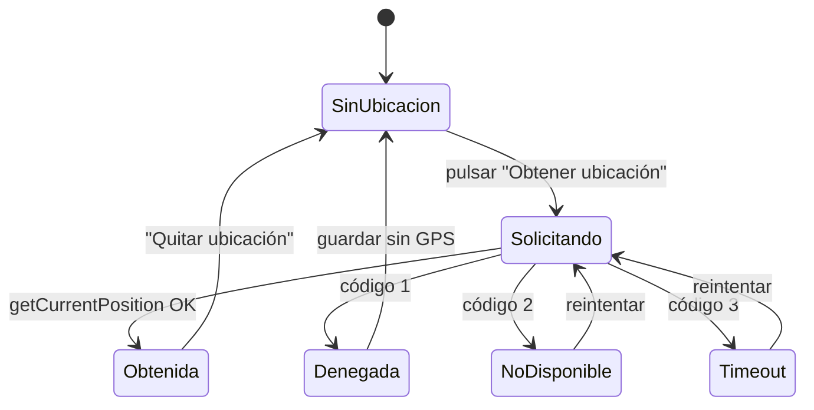
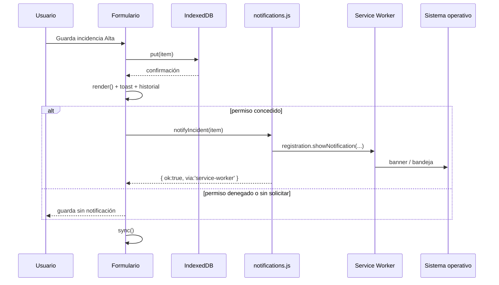
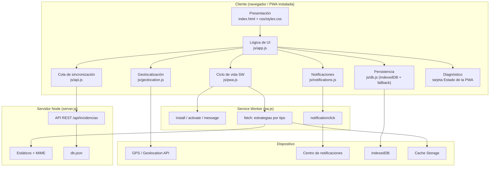

# Punto 1 — Planeación de la PWA «Alerta Campus»

> **Proyecto:** Registro de incidencias del campus
> **Versión analizada:** 1.0.0 (Service Worker `v5.0.1`)
> **Fecha:** 24 de octubre de 2026
> **Autor del análisis:** Equipo de desarrollo Full Stack
> **Documentos relacionados:** [Guía de integración](02-guia-integracion.md) · [Reporte de pruebas](05-reporte-pruebas.md) · [Evidencias](04-evidencias.md) · [Documento técnico](06-documento-tecnico.md)

---

## 1. Contexto y alcance

«Alerta Campus» es una PWA para que el personal y los estudiantes reporten incidencias
(fugas, luminarias, basura, árboles caídos, etc.) desde el teléfono. El escenario crítico
es **reportar en el lugar del incidente, donde la señal puede ser inexistente** (sótanos,
estacionamientos, edificios antiguos). Por eso la aplicación se diseña **offline-first**:
la escritura ocurre primero en el dispositivo y la red es un acelerador, no un requisito.

El alcance de esta planeación cubre:

1. Qué funciones exigen conectividad y cuáles deben operar sin ella.
2. La estrategia de caché para activos estáticos y dinámicos.
3. La característica física integrada: **geolocalización**.
4. La estrategia de notificaciones locales y su momento exacto de disparo.
5. La arquitectura de componentes y los criterios de aceptación verificables.

Quedan fuera del alcance: autenticación de usuarios, notificaciones push con servidor,
cámara/fotografía, geocodificación inversa y una base de datos relacional. Se documentan
como trabajo futuro.

---

## 2. Inventario funcional: conectividad obligatoria vs. operación offline

### 2.1 Criterio de clasificación

| Clasificación | Definición | Regla de diseño |
|---|---|---|
| **Requiere red** | Sin red la función no puede completar su objetivo y no existe una alternativa local razonable. | Se deshabilita o se difiere con un mensaje claro; nunca se pierde el trabajo del usuario. |
| **Offline-first** | La función debe completar su objetivo sin red; la red solo mejora la experiencia. | Se escribe en IndexedDB, se encola y se sincroniza después. |
| **Degradación elegante** | Funciona parcialmente sin red; la parte remota se muestra como no disponible. | Se conserva la parte local y se informa qué falta. |

### 2.2 Matriz funcional

| # | Función | ¿Requiere red? | Comportamiento sin conexión | Mecanismo / evidencia |
|---|---|---|---|---|
| F1 | Abrir la app por primera vez | **Sí** | No hay nada que cachear todavía; se muestra `offline.html` si el shell no está precargado. | Instalación inicial del SW. |
| F2 | Abrir la app después de la primera visita | No | Carga el shell desde caché y muestra los datos locales. | Network First con respaldo en `index.html`. |
| F3 | Crear incidencia | No | Se guarda en IndexedDB con `synced:false`; badge **Pendiente**. | `db.js` + `api.js`. |
| F4 | Editar incidencia | No | Se actualiza localmente, se marca pendiente y se conserva la versión más reciente. | `updated` + last-write-wins. |
| F5 | Eliminar incidencia | No | Borrado lógico (`deleted:true`) y eliminación física tras sincronizar. | Cola de pendientes. |
| F6 | Consultar historial, buscar y filtrar | No | Todo el filtrado ocurre en memoria sobre IndexedDB. | `render()` en `app.js`. |
| F7 | Ver resumen y gráficas | No | Se calculan con los datos locales. | `render()`. |
| F8 | Adjuntar ubicación GPS | **No** (GPS) | El GPS del dispositivo funciona sin datos; el enlace al mapa sí necesita red. | `geolocation.js`. |
| F9 | Ver el mapa de la incidencia | **Sí** | Se muestran coordenadas y precisión; el enlace a OpenStreetMap queda como acción que requiere conexión. | Enlace externo. |
| F10 | Sincronizar con el servidor | **Sí** | La cola queda pendiente y se reintenta al evento `online`, al abrir la app o con el botón. | `syncPending()`. |
| F11 | Descargar cambios de otros equipos | **Sí** | Se omite; no se pisa lo local. | `GET /api/incidencias`. |
| F12 | Recibir notificación local | No | Se emite con la app abierta o en segundo plano si el permiso está concedido. | `showNotification`. |
| F13 | Recibir notificación push remota | **Sí** | **No implementado** (fuera de alcance). | — |
| F14 | Comprobar actualización del SW | **Sí** | Si falla, se sigue usando la versión cacheada; se reintenta al volver a la pestaña. | `registration.update()`. |
| F15 | Instalar la PWA | **Sí** (primera vez) | El navegador descarga manifest, iconos y shell; después queda instalada. | Web App Manifest. |
| F16 | Diagnóstico interno (SW, caché, permisos) | No | Lee `caches`, `navigator.serviceWorker` y `navigator.permissions`. | Tarjeta «Estado de la PWA». |
| F17 | Imágenes de perfil del equipo | No | Se precargan en la instalación del SW. | `PRECACHE_URLS`. |
| F18 | Tipografías | No | Se usan fuentes del sistema; no hay dependencias externas. | CSS `system-ui`. |

### 2.3 Conclusión de la matriz

- **Nunca se bloquea la creación de una incidencia por falta de red.** Es el requisito
  funcional más importante y guía toda la arquitectura.
- **La red se usa para tres cosas:** sincronizar, descargar cambios remotos y comprobar
  actualizaciones. Las tres tienen un camino de degradación.
- **La ubicación no es obligatoria.** El formulario permite guardar sin GPS; esto evita
  que un permiso denegado o un sótano sin señal impidan reportar.

---

## 3. Estrategia de caché: activos estáticos vs. dinámicos

### 3.1 Principio

No todos los recursos merecen la misma estrategia. El shell debe abrir **rápido y siempre**;
los datos de la API deben ser **frescos o fallar**, nunca servirse obsoletos; las imágenes
pueden ser **inmutables durante la sesión**.

### 3.2 Matriz de estrategias

| Tipo de recurso | Ejemplos | Estrategia | Caché | Justificación |
|---|---|---|---|---|
| **Navegación / documento** | `/`, `/index.html`, `?action=new` | **Network First** con *timeout* natural de la red y respaldo en `index.html` | `alerta-campus-precache-v5.0.1` | Se intenta la versión más nueva; si no hay red, el shell cacheado mantiene la app usable. |
| **App shell estático** | `css/styles.css`, `js/*.js`, `manifest.json`, `icons/*`, `offline.html` | **Stale-While-Revalidate** | `precache` + `runtime` | Respuesta instantánea desde caché y actualización en segundo plano. |
| **Imágenes** | `imag1.png`…`image6.png` | **Cache First** con límite de 70 entradas | `alerta-campus-images-v5.0.1` | Son recursos pesados y poco cambiantes; se evita consumo de datos. |
| **API REST** | `/api/incidencias` | **Network Only** | Sin caché | Un listado viejo de incidencias es peor que un error: la verdad local está en IndexedDB. |
| **Recursos de terceros** | OpenStreetMap, fuentes externas | **Network Only** | Sin caché | No se controlan; además la app no depende de ellos para funcionar. |
| **Service Worker** | `/sw.js` | **Network Only** (el navegador lo actualiza por su cuenta) | Sin caché HTTP (`no-store`) | Debe detectar cambios de inmediato; cachearlo retrasa las actualizaciones. |

### 3.3 Precache (instalación)

En el evento `install` se precargan 24 recursos:

- Documento base y página offline.
- Manifest y hoja de estilos.
- Los 7 módulos JavaScript.
- 6 iconos (SVG, 192, 512, maskable, apple-touch, badge).
- Las 6 imágenes de perfil del equipo.

Si un recurso falla, la instalación falla y el SW anterior sigue activo. Esto es deliberado:
un shell incompleto es peor que un shell viejo.

### 3.4 Versionado y limpieza

- Los nombres de caché incluyen la versión (`v5.0.1`).
- En `activate` se eliminan todas las cachés que no pertenezcan a la versión actual.
- `clients.claim()` toma el control de las pestañas abiertas.
- La actualización **no** usa `skipWaiting()` automático: se avisa al usuario y este decide
  cuándo activar la nueva versión (evita recargas sorpresivas mientras redacta).

### 3.5 Límites y mantenimiento

- Caché de imágenes limitada a 70 entradas; se eliminan las más antiguas.
- No se cachean respuestas `206`, `opaque` ni errores.
- Las estrategias ignoran peticiones que no sean `GET` y orígenes distintos.
- El usuario puede limpiar la caché desde DevTools → Application → Storage.

---

## 4. Característica física seleccionada: geolocalización

### 4.1 Decisión

Se integra **Geolocation API** para adjuntar latitud, longitud y precisión a cada incidencia.
La captura es **opcional** y ocurre solo cuando el usuario pulsa «Obtener ubicación».

### 4.2 Justificación frente a la cámara

| Criterio | Geolocalización | Cámara / captura de imagen |
|---|---|---|
| Valor para una incidencia | Alto: ubica el problema en el campus. | Alto: evidencia visual. |
| Complejidad de permisos | Media (un permiso, estados claros). | Media-alta (permiso + selección de dispositivo + captura). |
| Almacenamiento | 3 números (~50 bytes). | Imágenes de MB; requiere IndexedDB de blobs, cuotas y compresión. |
| Funciona sin red | Sí (GPS). | Sí (cámara local), pero la subida posterior es más pesada. |
| Privacidad | Coordenadas del lugar, no de personas. | Rostros y contenido sensible; requiere más salvaguardas. |
| Riesgo de demo/evidencia | Bajo; se puede simular en DevTools. | Depende de hardware; difícil de reproducir en escritorio. |
| Integración con el formulario actual | Natural: «lugar del incidente». | Requiere nuevo campo, vista previa y gestión de archivos. |

**Decisión:** geolocalización. La cámara se documenta como evolución futura (ver
[Documento técnico §10](06-documento-tecnico.md#10-trabajo-futuro)).

### 4.3 Flujo y estados



| Estado | Mensaje al usuario | Acción permitida |
|---|---|---|
| `unsupported` | «Este dispositivo o navegador no soporta geolocalización…» | Guardar sin ubicación. |
| `insecure` | «La geolocalización requiere HTTPS o localhost…» | Guardar sin ubicación. |
| `prompt` | «Solicitando permiso y posición…» | Esperar / cancelar. |
| `granted` | Coordenadas + precisión + enlace al mapa. | Guardar, actualizar o quitar. |
| `permission_denied` | «Permiso de ubicación denegado. Habilítalo en los ajustes…» | Guardar sin ubicación. |
| `position_unavailable` | «No se pudo obtener la posición…» | Reintentar o guardar sin GPS. |
| `timeout` | «La ubicación tardó demasiado…» | Reintentar o guardar sin GPS. |

### 4.4 Parámetros y datos

```js
{
  enableHighAccuracy: true,
  timeout: 12000,      // 12 s
  maximumAge: 30000    // reutiliza una posición de hasta 30 s
}
```

Se añade un temporizador de seguridad de 14 s para que la promesa nunca quede colgada si
el navegador no invoca ningún callback.

Datos persistidos por incidencia:

| Campo | Tipo | Ejemplo | Nota |
|---|---|---|---|
| `lat` | number | `19.4326` | 6 decimales. |
| `lng` | number | `-99.1332` | 6 decimales. |
| `accuracy` | number \| null | `25` | metros. |
| `geoAt` | ISO string \| null | `2026-10-24T14:35:00.000Z` | momento de captura. |

### 4.5 Privacidad

- La ubicación se solicita solo por acción explícita; no hay geolocalización en segundo plano.
- Se guarda junto a la incidencia y se envía al servidor solo al sincronizar.
- El enlace a OpenStreetMap se abre en una pestaña nueva y envía las coordenadas a un tercero.
  Se documenta en la interfaz («el mapa requiere conexión»).
- El usuario puede quitar la ubicación antes de guardar.

---

## 5. Estrategia de notificaciones

### 5.1 Tipo

**Notificación local**, no push. Se emite desde el cliente con
`ServiceWorkerRegistration.showNotification()`. No hay servidor de push, claves VAPID ni
suscripción `PushManager`; por tanto no se puede despertar la app si está cerrada.

### 5.2 Disparadores y momento exacto

| # | Disparador | Momento exacto | Condición | Propósito |
|---|---|---|---|---|
| N1 | **Incidencia de prioridad Alta guardada** | Inmediatamente después de que `put()` confirma la escritura en IndexedDB, se refresca la UI y se muestra el historial; antes de lanzar `sync()`. | `prioridad === 'Alta'` **y** `Notification.permission === 'granted'`. | Avisar al usuario de que el reporte crítico quedó registrado. |
| N2 | **Botón «Probar notificación»** | Al pulsarlo, tras conceder el permiso si hacía falta. | Permiso concedido. | Diagnóstico y evidencia de que el canal funciona. |
| N3 | **Botón «Activar notificaciones»** | Solo solicita permiso; no muestra notificación. | Permiso en estado `default`. | Evitar el prompt automático y cumplir las buenas prácticas. |

No se muestra ninguna notificación al cargar la página ni al sincronizar. Esto evita
interrumpir y evita que el navegador bloquee el permiso por falta de gesto de usuario.



### 5.3 Permiso y UX

- El permiso se pide **solo** con un clic en «Activar notificaciones» o «Probar notificación».
- Si el usuario deniega, el botón de prueba se deshabilita y se explica cómo revertirlo en
  los ajustes del navegador. No se insiste en cada carga.
- En Android, `new Notification()` no está permitido; por eso se usa siempre
  `registration.showNotification()`.
- En iOS, las notificaciones web requieren que la PWA esté **instalada en la pantalla de
  inicio** (iOS 16.4+). Se documenta en la interfaz y en el reporte de pruebas.

### 5.4 Contenido y comportamiento

| Campo | Valor |
|---|---|
| `title` | `Incidencia de prioridad Alta` |
| `body` | Título + detalles (máx. 180 caracteres). |
| `tag` | `incidencia-<id>` (agrupa y evita duplicados). |
| `icon` / `badge` | `icons/icon-192.png` / `icons/badge-72.png`. |
| `data.url` | `./index.html?action=list`. |
| `renotify` | `true` (con `tag`). |
| `vibrate` | `[120, 60, 120]` cuando el dispositivo lo soporta. |
| `actions` | Apertura del historial (donde el navegador lo soporte). |

Al tocar la notificación, el SW enfoca una ventana existente o abre una nueva en el historial.

---

## 6. Arquitectura de componentes

### 6.1 Diagrama en bloques



### 6.2 Diagrama textual (alternativo)

```
┌──────────────────────────── DISPOSITIVO ────────────────────────────┐
│                                                                     │
│  ┌──────────────┐   ┌──────────────┐   ┌─────────────────────────┐  │
│  │  index.html  │──▶│   app.js     │──▶│  DOM / vistas / forms   │  │
│  │  styles.css  │   │  (orquesta)  │   └─────────────────────────┘  │
│  └──────────────┘   └──────┬───────┘                                │
│                            │                                        │
│        ┌───────────────────┼───────────────────┐                    │
│        ▼                   ▼                   ▼                    │
│  ┌───────────┐      ┌─────────────┐      ┌─────────────┐            │
│  │  db.js    │      │   api.js    │      │ geo/notif   │            │
│  │ IndexedDB │      │  cola sync  │      │ APIs física │            │
│  └───────────┘      └──────┬──────┘      └──────┬──────┘            │
│                            │                    │                   │
│  ┌─────────────────────────▼────────────────────▼───────────────┐   │
│  │                    Service Worker (sw.js)                    │   │
│  │  precache · network-first · SWR · cache-first · notif click  │   │
│  └─────────────────────────┬────────────────────────────────────┘   │
│                            │                                        │
│  ┌─────────────────────────▼────────────────────────────────────┐   │
│  │              Cache Storage (precache/runtime/images)          │   │
│  └───────────────────────────────────────────────────────────────┘   │
└────────────────────────────────┬────────────────────────────────────┘
                                 │ HTTPS / localhost
                    ┌────────────▼─────────────┐
                    │  Servidor Node + API REST │
                    │  estáticos · db.json      │
                    └───────────────────────────┘
```

### 6.3 Responsabilidades por módulo

| Componente | Archivo | Responsabilidad | No debe hacer |
|---|---|---|---|
| Presentación | `index.html` | Estructura semántica, formularios, iconos SVG, IDs estables. | Lógica de negocio ni acceso a datos. |
| Estilos | `css/styles.css` | Diseño responsive, estados visuales, accesibilidad. | Manipulación del DOM. |
| Orquestador | `js/app.js` | Navegación, render, CRUD, permisos, diagnóstico. | Abrir IndexedDB directamente. |
| Persistencia | `js/db.js` | IndexedDB + respaldo localStorage. | Conocer la UI. |
| Red | `js/api.js` | Cola, `fetch`, conflictos, descarga remota. | Tocar el DOM. |
| Utilidades | `js/ui.js` | `$`, `esc`, `ic`, `uid`, `fmtDate`, `toast`. | Estado de negocio. |
| Física | `js/geolocation.js` | Soporte, permisos, timeout, errores, URL de mapa. | Renderizar. |
| Notificaciones | `js/notifications.js` | Permiso, `showNotification`, payload. | Decidir cuándo avisar (lo decide `app.js`). |
| Ciclo SW | `js/pwa.js` | Registro, actualización, `SKIP_WAITING`, persistencia. | Estrategias de caché (viven en `sw.js`). |
| Service Worker | `sw.js` | Precarga, estrategias, limpieza, click de notificación. | Lógica de negocio ni acceso a IndexedDB. |
| Servidor | `server.js` | Estáticos, API, validación, persistencia, MIME. | Renderizar la UI. |

### 6.4 Estructura de archivos

```text
pwa-incidencias/
├── index.html                  # Shell y vistas (Inicio, Nueva, Historial)
├── offline.html                # Fallback cuando no hay shell cacheado
├── manifest.json               # Metadatos de instalación
├── sw.js                       # Service Worker
├── server.js                   # Servidor Node + API REST
├── package.json                # Scripts de desarrollo/pruebas
├── db.json                     # Base de datos local (no versionada)
├── css/
│   └── styles.css              # Diseño completo
├── js/
│   ├── app.js                  # Orquestador de UI
│   ├── db.js                   # IndexedDB + localStorage
│   ├── api.js                  # Sincronización
│   ├── ui.js                   # Utilidades de UI
│   ├── geolocation.js          # Característica física
│   ├── notifications.js        # Notificaciones locales
│   └── pwa.js                  # Registro/actualización del SW
├── icons/
│   ├── icon.svg
│   ├── icon-192.png
│   ├── icon-512.png
│   ├── icon-maskable-512.png
│   ├── apple-touch-icon.png
│   └── badge-72.png
├── docs/
│   ├── 01-planeacion.md
│   ├── 02-guia-integracion.md
│   ├── 03-github-despliegue.md
│   ├── 04-evidencias.md
│   ├── 05-reporte-pruebas.md
│   ├── 06-documento-tecnico.md
│   └── evidencias/*.png
├── tests/
│   ├── e2e.mjs                 # Pruebas E2E con Edge + CDP
│   └── results/report.json     # Resultado reproducible
└── tools/
    └── generate-icons.py       # Generación de iconos PNG
```

### 6.5 Flujo de datos de una incidencia

1. El usuario completa el formulario y, opcionalmente, captura la ubicación.
2. `app.js` construye el objeto con `id` UUID, `fecha`, `updated`, `synced:false`.
3. `db.js` guarda en IndexedDB (o localStorage si IndexedDB falla).
4. La UI se re-renderiza; si es Alta y hay permiso, se emite la notificación local.
5. `api.js` intenta POST/PUT/DELETE si hay red; si no, deja la cola.
6. Al volver la red, el evento `online` dispara `sync()`; se envían pendientes y se
   descargan cambios remotos.
7. El servidor aplica *last-write-wins* por `updated` y deduplica por `id`.

---

## 7. Criterios de aceptación

| ID | Criterio | Cómo se verifica | Estado |
|---|---|---|---|
| AC-01 | La app es instalable (manifest, iconos 192/512, `display:standalone`, HTTPS/localhost). | `Page.getAppManifest` + `Page.getInstallabilityErrors`; botón «Instalar app». | Cumplido |
| AC-02 | El Service Worker se registra, activa y controla la página. | Tarjeta «Estado de la PWA» + DevTools → Application. | Cumplido |
| AC-03 | La app abre sin conexión después de la primera visita. | DevTools → Network → Offline + recarga. | Cumplido |
| AC-04 | Se pueden crear, editar, consultar y eliminar incidencias sin red. | Pruebas CP-08/CP-09/CP-12/CP-13. | Cumplido |
| AC-05 | La cola se sincroniza al reconectar sin duplicados. | CP-10/CP-11. | Cumplido |
| AC-06 | El permiso de notificaciones se pide solo por gesto y la notificación local se emite. | CP-03/CP-06. | Cumplido |
| AC-07 | La geolocalización maneja éxito, denegación y error sin bloquear el guardado. | CP-04/CP-07. | Cumplido |
| AC-08 | La UI es responsive (móvil 390px y escritorio 1280px). | CP-14. | Cumplido |
| AC-09 | No hay excepciones de JavaScript en el recorrido. | CP-15. | Cumplido |
| AC-10 | La actualización del SW avisa y no recarga sin permiso. | Revisión de `pwa.js` + prueba manual del banner. | Cumplido (manual) |

---

## 8. Riesgos y mitigaciones

| Riesgo | Impacto | Probabilidad | Mitigación |
|---|---|---|---|
| El usuario nunca visita la app con red y no hay shell cacheado. | Alto | Baja | `offline.html` explicativo; instalar/abrir una vez con red. |
| Permiso de notificaciones denegado permanentemente. | Medio | Media | No se insiste; se indica cómo reactivar; la app sigue funcionando. |
| GPS impreciso o sin señal en interiores. | Medio | Alta | Se muestra `accuracy`; la ubicación es opcional; se permite reintentar. |
| Cuota de almacenamiento insuficiente. | Medio | Baja | Fallback a localStorage; límite de imágenes; IndexedDB es pequeño. |
| Datos obsoletos en caché tras un despliegue. | Medio | Media | Versionado de caché, `skipWaiting` manual, `no-store` para `sw.js`. |
| Conflictos de edición entre dispositivos. | Medio | Baja | `updated` + last-write-wins; el cliente conserva su cambio si es más reciente. |
| API sin autenticación. | Alto en producción | Alta | Documentado; añadir auth/RBAC antes de datos reales (trabajo futuro). |
| iOS no soporta `beforeinstallprompt` ni push sin instalar. | Medio | Alta | Instrucciones manuales «Compartir → Añadir a pantalla de inicio». |
| Notificaciones no visibles en modo headless. | Bajo (pruebas) | Alta | Se verifica con `getNotifications()`; captura manual del banner del SO. |

---

## 9. Decisiones de arquitectura (resumen tipo ADR)

| ADR | Decisión | Alternativa descartada | Motivo |
|---|---|---|---|
| ADR-01 | JavaScript Vanilla con módulos ES. | React/Vue. | Cero dependencias, carga rápida, control total del shell y del SW; el equipo ya tenía la UI. |
| ADR-02 | IndexedDB como fuente local. | localStorage únicamente. | Mayor cuota, transacciones y mejor rendimiento; localStorage queda como respaldo. |
| ADR-03 | Sincronización por cola con `synced` y `updated`. | Sincronización en tiempo real. | No requiere servidor de sockets ni conexión permanente; tolera días offline. |
| ADR-04 | API Network Only. | Cachear respuestas de la API. | Evita mostrar incidencias obsoletas; la verdad local está en IndexedDB. |
| ADR-05 | Geolocalización en lugar de cámara. | Captura de imagen. | Menor complejidad, menor almacenamiento, encaja con «lugar del incidente» y es más fácil de evidenciar. |
| ADR-06 | Notificación local, no push. | Web Push + VAPID. | El alcance no incluye servidor de push; la notificación local cubre el caso de uso. |
| ADR-07 | Actualización del SW con aviso. | `skipWaiting()` automático. | Evita recargas mientras el usuario redacta; da control y transparencia. |

---

## 10. Entregables derivados de esta planeación

| Entregable | Archivo |
|---|---|
| Código del Service Worker y estrategias | [`sw.js`](../sw.js) |
| Módulos de la aplicación | [`js/`](../js/) |
| Manifest e iconos | [`manifest.json`](../manifest.json), [`icons/`](../icons/) |
| Guía de integración | [02-guia-integracion.md](02-guia-integracion.md) |
| Guía de GitHub y despliegue | [03-github-despliegue.md](03-github-despliegue.md) |
| Plantilla y capturas de evidencia | [04-evidencias.md](04-evidencias.md) |
| Reporte formal de pruebas | [05-reporte-pruebas.md](05-reporte-pruebas.md) |
| Documento técnico | [06-documento-tecnico.md](06-documento-tecnico.md) |

