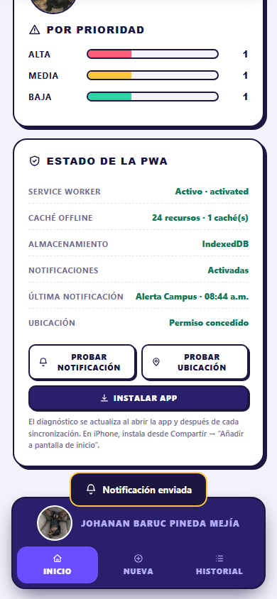
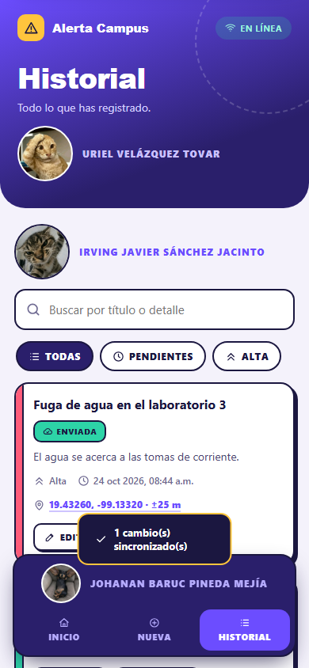
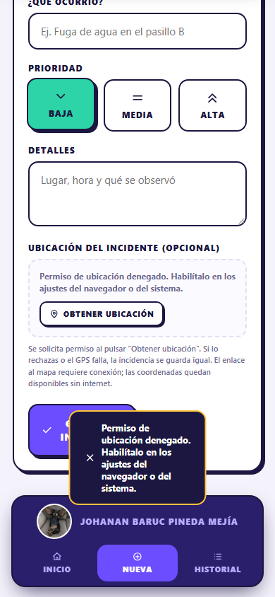
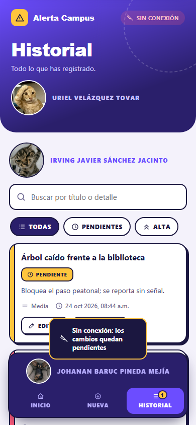
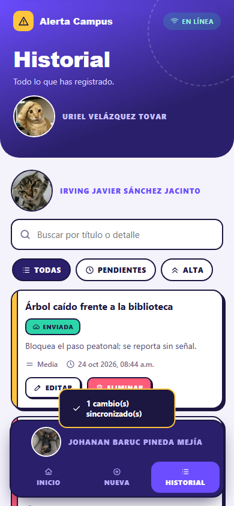
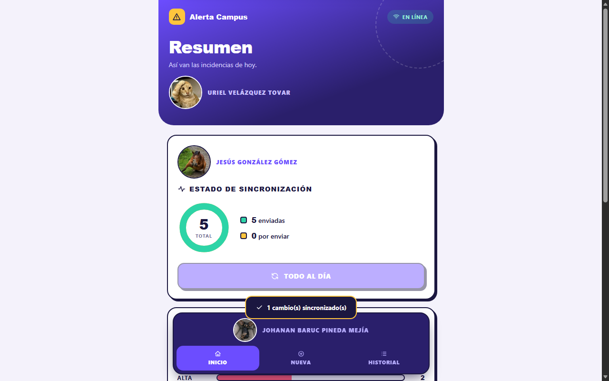

# Punto 3.3 — Capturas de pantalla: explicación y justificación

> **Proyecto:** Alerta Campus — Registro de Incidencias
> **Fecha de captura:** 24 de octubre de 2026
> **Entorno automatizado:** Microsoft Edge headless (CDP), viewport 390×844 (móvil) y
> 1280×800 (escritorio), servidor `http://127.0.0.1:3100`.
> **Datos:** base de prueba aislada (`tests/.tmp/db.json`) con 3 incidencias semilla.
> **Reproducible con:** `node tests/e2e.mjs` → genera las 10 imágenes de esta carpeta y
> `tests/results/report.json`.

---

## 1. Cómo leer esta plantilla

Cada evidencia contiene:

| Campo | Qué debe responder |
|---|---|
| **ID** | Identificador único de la captura. |
| **Funcionalidad** | Requisito del entregable que se está evidenciando. |
| **Objetivo** | Qué se quiere demostrar con la imagen. |
| **Pasos** | Cómo reproducirla. |
| **Captura** | Imagen incrustada. |
| **Explicación** | Qué se observa exactamente en la imagen. |
| **Justificación técnica** | Por qué esa imagen demuestra el requisito (API, estado, dato). |
| **Resultado** | Aprobado / observación. |

> **Nota de transparencia:** las capturas se generaron con un navegador *headless*. Eso
> permite automatizar y reproducir el 100% del flujo, pero **no muestra los diálogos nativos
> del sistema operativo** (prompt de permiso, banner de notificación, selector de instalación).
> Para esos casos se incluyen plantillas manuales (sección 5) que deben completarse en un
> dispositivo real antes de la entrega final. Las capturas automáticas sí prueban el estado
> de la API y del Service Worker.

---

## 2. Ficha técnica de la sesión

| Dato | Valor |
|---|---|
| Navegador | Microsoft Edge 156.0.4314.42 (headless) |
| Sistema | Windows 11 |
| Node.js | v26.5.1 |
| Servidor | `server.js` en `127.0.0.1:3100` |
| Service Worker | `alerta-campus-precache-v5.0.1` |
| Almacenamiento | IndexedDB `incidenciasDB` |
| Permisos | Geolocalización y notificaciones concedidos vía CDP |
| Geolocalización simulada | 19.4326, -99.1332 (±25 m) |
| Red | Emulación offline/online con CDP `Network.emulateNetworkConditions` |

---

## 3. Evidencias automáticas

### E-01 — Carga inicial, Service Worker y estado en línea

| Campo | Detalle |
|---|---|
| **ID** | E-01 |
| **Funcionalidad** | Service Worker activo + app shell operativa |
| **Objetivo** | Demostrar que la PWA carga, sincroniza datos y muestra el estado de conexión. |
| **Pasos** | 1. Abrir `http://127.0.0.1:3100/`. 2. Esperar a que el splash desaparezca. 3. Capturar la vista Inicio. |
| **Archivo** | `evidencias/01-home-online.png` |
| **Caso relacionado** | CP-01 |


**Explicación.** La cabecera muestra «EN LÍNEA» con el icono de Wi-Fi. El resumen indica
3 incidencias, 3 enviadas y 0 por enviar; el botón «Todo al día» está deshabilitado porque
no hay pendientes. Los datos provienen del servidor y se sincronizaron al abrir.

**Justificación técnica.** El estado «En línea» lo pinta `net()` a partir de
`navigator.onLine`; los contadores se calculan con `all()` sobre IndexedDB después de que
`syncPending()` descargara las 3 incidencias semilla. Si el SW no controlara la página, la
recarga offline del CP-08 no sería posible.

**Resultado:** aprobado.

---

### E-02 — Diagnóstico interno de la PWA

| Campo | Detalle |
|---|---|
| **ID** | E-02 |
| **Funcionalidad** | Service Worker, Cache Storage, almacenamiento y permisos |
| **Objetivo** | Evidenciar el estado real del SW y de la caché sin depender de DevTools. |
| **Pasos** | 1. Desplazarse a la tarjeta «Estado de la PWA». 2. Verificar cada fila. 3. Capturar. |
| **Archivo** | `evidencias/02-diagnostico-pwa.png` |
| **Caso relacionado** | CP-01, CP-02, CP-03 |


**Explicación.** Se lee:

| Fila | Valor observado | Lectura |
|---|---|---|
| Service Worker | `Activo · activated` | El SW está registrado, activado y controlando la página. |
| Caché offline | `24 recursos · 1 caché(s)` (puede variar a 25/2 tras la primera navegación) | El precache contiene el shell completo. |
| Almacenamiento | `IndexedDB` | La persistencia principal está operativa. |
| Notificaciones | `Activadas` | El permiso está concedido. |
| Última notificación | `—` / título de la última | Estado del canal local. |
| Ubicación | `Permiso concedido` | La geolocalización está autorizada. |

También aparece el botón **«Instalar app»**, lo que confirma que el navegador disparó
`beforeinstallprompt` (manifest e iconos válidos).

**Justificación técnica.** `renderDiag()` consulta `navigator.serviceWorker.getRegistration()`,
`caches.keys()` + `cache.keys()`, `storageMode()`, `Notification.permission` y
`navigator.permissions.query({name:'geolocation'})`. No es una maqueta: son los valores
reales del navegador en ese instante.

**Resultado:** aprobado.

---

### E-03 — Permiso y notificación local

| Campo | Detalle |
|---|---|
| **ID** | E-03 |
| **Funcionalidad** | Notifications API + `showNotification` |
| **Objetivo** | Demostrar que el permiso está activo, que la notificación se emite y que la app
registra el último envío. |
| **Pasos** | 1. Conceder el permiso. 2. Pulsar «Probar notificación». 3. Capturar antes de que
desaparezca el aviso. 4. Verificar con `registration.getNotifications()`. |
| **Archivo** | `evidencias/03-notificacion.png` |
| **Caso relacionado** | CP-03, CP-06 |



**Explicación.** La fila «Notificaciones» está en **Activadas**, la fila «Última
notificación» muestra **Alerta Campus · 08:44 a.m.** y el aviso inferior confirma
**«Notificación enviada»**. En la misma sesión, `getNotifications()` devolvió:

```json
[{
  "title": "Alerta Campus",
  "body": "Las notificaciones locales funcionan. Toca para abrir el historial.",
  "tag": "alerta-campus-prueba"
}]
```

Y al guardar una incidencia de prioridad Alta se añadió:

```json
{
  "title": "Incidencia de prioridad Alta",
  "body": "Fuga de agua en el laboratorio 3 · El agua se acerca a las tomas de corriente.",
  "tag": "incidencia-841ca7e8-72ef-4f09-a9aa-4e16d1e6520d"
}
```

**Justificación técnica.** La notificación se creó con
`ServiceWorkerRegistration.showNotification()` (no con `new Notification`), que es el camino
obligatorio en Android. El payload se recupera con `getNotifications()` desde la página y
coincide con el configurado en `notifyIncident()`.

**Limitación de la captura.** El banner nativo del sistema operativo no se renderiza en modo
headless. La captura prueba la emisión y el estado; para la evidencia visual del banner usa
la plantilla **M-02** en un dispositivo real.

**Resultado:** aprobado (emisión verificada por API). Banner del SO: pendiente de captura manual.

---

### E-04 — Geolocalización: permiso concedido y captura

| Campo | Detalle |
|---|---|
| **ID** | E-04 |
| **Funcionalidad** | Geolocation API |
| **Objetivo** | Demostrar la captura de latitud, longitud y precisión, y su presentación en el formulario. |
| **Pasos** | 1. Ir a «Nueva». 2. Pulsar «Obtener ubicación». 3. Aceptar el permiso. 4. Capturar la tarjeta de ubicación. |
| **Archivo** | `evidencias/04-geolocalizacion.png` |
| **Caso relacionado** | CP-04 |


**Explicación.** El bloque «Ubicación del incidente (opcional)» está resaltado, muestra
**19.43260, -99.13320 · ±25 m**, el enlace **«Abrir en OpenStreetMap ↗»** y el botón
**«Quitar ubicación»**. El aviso confirma «Ubicación adjuntada».

**Justificación técnica.** `requestPosition()` llamó a
`navigator.geolocation.getCurrentPosition()` con `enableHighAccuracy:true`, `timeout:12000` y
`maximumAge:30000`; redondeó a 6 decimales y guardó la precisión en metros. La UI usa
`geo.mapUrl()` para construir la URL de OpenStreetMap y `formatCoords()` para el texto.

**Resultado:** aprobado.

---

### E-05 — Historial con ubicación y sincronización

| Campo | Detalle |
|---|---|
| **ID** | E-05 |
| **Funcionalidad** | Persistencia + enlace de mapa + envío al servidor |
| **Objetivo** | Demostrar que la incidencia guardada conserva la ubicación y se sincroniza. |
| **Pasos** | 1. Guardar la incidencia del paso anterior. 2. Ir a «Historial». 3. Capturar la tarjeta. |
| **Archivo** | `evidencias/05-historial-geo.png` |
| **Caso relacionado** | CP-05 |



**Explicación.** La tarjeta «Fuga de agua en el laboratorio 3» tiene el badge **ENVIADA**, la
prioridad **Alta**, la fecha y la línea de ubicación **19.43260, -99.13320 · ±25 m** con
enlace al mapa. El aviso «1 cambio(s) sincronizado(s)» confirma el envío.

**Justificación técnica.** El objeto guardado incluye `lat`, `lng`, `accuracy` y `geoAt`.
`payload()` los incluye en el POST; el servidor los valida (`|lat| ≤ 90`, `|lng| ≤ 180`) y los
persiste. La evidencia del servidor se verificó en el arnés:

```json
{ "titulo": "Fuga de agua en el laboratorio 3", "lat": 19.4326, "lng": -99.1332 }
```

**Resultado:** aprobado.

---

### E-06 — Geolocalización: permiso denegado

| Campo | Detalle |
|---|---|
| **ID** | E-06 |
| **Funcionalidad** | Manejo de errores de Geolocation API |
| **Objetivo** | Demostrar que la denegación se explica y no bloquea el guardado. |
| **Pasos** | 1. Bloquear el permiso de ubicación. 2. Ir a «Nueva». 3. Pulsar «Obtener ubicación». 4. Capturar. |
| **Archivo** | `evidencias/06-geo-denegado.png` |
| **Caso relacionado** | CP-07 |



**Explicación.** El bloque de ubicación permanece en estado neutro y el texto indica:
**«Permiso de ubicación denegado. Habilítalo en los ajustes del navegador o del sistema.»**
El botón «Guardar incidencia» sigue disponible. El aviso inferior repite el mensaje.

**Justificación técnica.** El callback de error de `getCurrentPosition` recibe `code = 1` y
`GeoError('permission_denied')`; `describeError()` traduce el código a un mensaje accionable.
La ubicación es opcional, así que `geoFields` queda en `null` y el guardado continúa.

**Resultado:** aprobado.

---

### E-07 — Modo offline con recarga

| Campo | Detalle |
|---|---|
| **ID** | E-07 |
| **Funcionalidad** | Service Worker + Cache Storage |
| **Objetivo** | Demostrar que la app abre sin red y conserva los datos. |
| **Pasos** | 1. Cargar la app una vez. 2. DevTools → Network → Offline (o CDP). 3. Recargar. 4. Capturar. |
| **Archivo** | `evidencias/07-offline.png` |
| **Caso relacionado** | CP-08 |


**Explicación.** La cabecera muestra **«SIN CONEXIÓN»** con el icono de Wi-Fi tachado. El
resumen conserva **4 incidencias** y **0 por enviar**. La app cargó desde el shell cacheado.

**Justificación técnica.** La navegación usa Network First; al fallar `fetch`, el SW responde
con `caches.match(request, {ignoreSearch:true})` y luego con `./index.html`. Los datos no
vienen de la caché HTTP: se leen de IndexedDB, que sigue disponible offline. El diagnóstico
confirma `controller: true` y una caché con decenas de recursos.

**Resultado:** aprobado.

---

### E-08 — Alta de incidencia sin conexión

| Campo | Detalle |
|---|---|
| **ID** | E-08 |
| **Funcionalidad** | Escritura offline + cola de pendientes |
| **Objetivo** | Demostrar que se puede crear una incidencia sin red y que queda pendiente. |
| **Pasos** | 1. Sin conexión, ir a «Nueva». 2. Completar y guardar. 3. Ir a «Historial». 4. Capturar. |
| **Archivo** | `evidencias/08-pendiente-offline.png` |
| **Caso relacionado** | CP-09 |



**Explicación.** La tarjeta «Árbol caído frente a la biblioteca» muestra el badge
**PENDIENTE**, la prioridad Media y el aviso «Sin conexión: los cambios quedan pendientes».
El contador de la pestaña Historial muestra **1**.

**Justificación técnica.** El guardado es local-first: `put()` escribe en IndexedDB con
`synced:false`; `sync()` Detecta `navigator.onLine === false` y no intenta la red. El
contador `#pen` y el badge se calculan con `rows.filter(i => !i.synced)`. No se pierde nada.

**Resultado:** aprobado.

---

### E-09 — Reconexión y sincronización automática

| Campo | Detalle |
|---|---|
| **ID** | E-09 |
| **Funcionalidad** | Cola de sincronización + evento `online` |
| **Objetivo** | Demostrar que al recuperar la red se envía lo pendiente y se limpia el contador. |
| **Pasos** | 1. Partir de E-08. 2. Restaurar la red. 3. Esperar el evento `online`. 4. Capturar. |
| **Archivo** | `evidencias/09-sincronizado.png` |
| **Caso relacionado** | CP-10, CP-11 |



**Explicación.** La tarjeta «Árbol caído frente a la biblioteca» ahora tiene el badge
**ENVIADA**. La cabecera muestra **«EN LÍNEA»** y el aviso confirma
**«1 cambio(s) sincronizado(s)»**. El servidor contiene la incidencia.

**Justificación técnica.** El evento `online` llama a `net()` y a `sync({silent:true})`;
`syncPending()` recorre los pendientes, hace POST y marca `synced:true` y `onServer:true`.
La idempotencia se verificó con dos POST del mismo `id`: el servidor devolvió `201/200` y
dejó **una sola copia** (CP-11).

**Resultado:** aprobado.

---

### E-10 — Diseño responsive de escritorio

| Campo | Detalle |
|---|---|
| **ID** | E-10 |
| **Funcionalidad** | UI responsive |
| **Objetivo** | Demostrar que la app se adapta a escritorio sin romper la navegación. |
| **Pasos** | 1. Cambiar el viewport a 1280×800. 2. Ir a Inicio. 3. Capturar. |
| **Archivo** | `evidencias/10-escritorio.png` |
| **Caso relacionado** | CP-14 |



**Explicación.** El contenido queda centrado en una columna de **600 px**; la navegación
inferior sigue fija y con el mismo lenguaje visual. Las tarjetas mantienen bordes, sombras y
jerarquía.

**Justificación técnica.** `.app{max-width:600px;margin:auto}` y `nav{position:fixed}`. El
arnés midió `getBoundingClientRect().width === 600` y `position === 'fixed'`.

**Resultado:** aprobado.

---

## 4. Matriz de cobertura de evidencias

| Requisito | Evidencia automática | Evidencia manual |
|---|---|---|
| Service Worker activo | E-02, E-07 | M-03, M-05 |
| Modo offline funcionando | E-07, E-08 | M-05 |
| Permiso y despliegue de notificación | E-03 | M-02 |
| Uso de la característica física (geolocalización) | E-04, E-05, E-06 | M-01 |
| Instalación de la PWA | E-02 (botón «Instalar app») | M-04 |
| Sincronización | E-01, E-05, E-09 | — |
| Responsive | E-10 | — |

---

## 5. Plantillas para capturas manuales

Completa estas fichas en un dispositivo real (Android/iPhone/escritorio) antes de la entrega
final. Guarda las imágenes en `docs/evidencias/` con el nombre indicado.

### M-01 — Prompt nativo de permiso de ubicación

| Campo | Detalle |
|---|---|
| **ID** | M-01 |
| **Funcionalidad** | Solicitud de permiso de geolocalización |
| **Objetivo** | Mostrar el diálogo del navegador/sistema y la elección del usuario. |
| **Pasos** | 1. Abrir la PWA en HTTPS. 2. Ir a «Nueva». 3. Pulsar «Obtener ubicación». 4. Capturar el prompt **antes** de responder. |
| **Archivo sugerido** | `evidencias/11-permiso-geolocalizacion.png` |
| **Qué debe verse** | El origen HTTPS, el mensaje «¿Permitir que este sitio conozca tu ubicación?» y los botones Permitir/Bloquear. |
| **Explicación** | ... |
| **Justificación** | Demuestra que el permiso se solicita por acción del usuario y no al cargar. |
| **Resultado** | ... |

> Imagen pendiente: `evidencias/11-permiso-geolocalizacion.png`

### M-02 — Banner nativo de notificación

| Campo | Detalle |
|---|---|
| **ID** | M-02 |
| **Funcionalidad** | Notificación local visible |
| **Objetivo** | Mostrar el banner del sistema con el título y el cuerpo configurados. |
| **Pasos** | 1. Activar notificaciones. 2. Pulsar «Probar notificación» o guardar una incidencia Alta. 3. Capturar la barra de notificaciones / centro de notificaciones. |
| **Archivo sugerido** | `evidencias/12-notificacion-sistema.png` |
| **Qué debe verse** | Icono de Alerta Campus, título «Incidencia de prioridad Alta» o «Alerta Campus», cuerpo y hora. |
| **Explicación** | ... |
| **Justificación** | Confirma que `showNotification` llegó al sistema operativo, no solo a la API. |
| **Resultado** | ... |

> Imagen pendiente: `evidencias/12-notificacion-sistema.png`

### M-03 — Aviso de nueva versión y activación del SW

| Campo | Detalle |
|---|---|
| **ID** | M-03 |
| **Funcionalidad** | Actualización del Service Worker |
| **Objetivo** | Mostrar el banner «Hay una nueva versión…» y la recarga controlada. |
| **Pasos** | 1. Con la app abierta, cambiar `VERSION` en `sw.js` y desplegar. 2. Recargar. 3. Esperar el banner. 4. Capturar. 5. Pulsar «Actualizar» y verificar la recarga. |
| **Archivo sugerido** | `evidencias/13-actualizacion-sw.png` |
| **Qué debe verse** | El aviso superior con el botón «Actualizar» y el estado `waiting` en DevTools. |
| **Explicación** | ... |
| **Justificación** | Demuestra que no se fuerza `skipWaiting` y que el usuario controla la activación. |
| **Resultado** | ... |

> Imagen pendiente: `evidencias/13-actualizacion-sw.png`

### M-04 — Instalación de la PWA

| Campo | Detalle |
|---|---|
| **ID** | M-04 |
| **Funcionalidad** | Instalabilidad |
| **Objetivo** | Mostrar el prompt de instalación o la app instalada. |
| **Pasos** | 1. Abrir en Chrome/Edge. 2. Pulsar «Instalar app» o el icono de instalación de la barra. 3. Capturar el diálogo y la app en modo standalone. |
| **Archivo sugerido** | `evidencias/14-instalacion.png` |
| **Qué debe verse** | Nombre «Alerta Campus», icono y botón Instalar; luego la app sin barra de navegador. |
| **Explicación** | ... |
| **Justificación** | Confirma manifest, iconos, `start_url` y `display:standalone`. |
| **Resultado** | ... |

> Imagen pendiente: `evidencias/14-instalacion.png`

### M-05 — Panel de DevTools (opcional, refuerzo técnico)

| Campo | Detalle |
|---|---|
| **ID** | M-05 |
| **Funcionalidad** | Evidencia técnica del SW y Cache Storage |
| **Objetivo** | Mostrar `Application → Service Workers` y `Cache Storage` con los recursos. |
| **Pasos** | 1. DevTools → Application. 2. Capturar el SW `activated and is running`. 3. Capturar la caché `alerta-campus-precache-v5.0.1`. |
| **Archivo sugerido** | `evidencias/15-devtools.png` |
| **Qué debe verse** | Estado del SW, scope y lista de recursos cacheados. |
| **Explicación** | ... |
| **Justificación** | Corrobora desde la herramienta del navegador lo que muestra E-02. |
| **Resultado** | ... |

> Imagen pendiente: `evidencias/15-devtools.png`

---

## 6. Convenciones de nombres y organización

```text
docs/evidencias/
├── 01-home-online.png
├── 02-diagnostico-pwa.png
├── 03-notificacion.png
├── 04-geolocalizacion.png
├── 05-historial-geo.png
├── 06-geo-denegado.png
├── 07-offline.png
├── 08-pendiente-offline.png
├── 09-sincronizado.png
├── 10-escritorio.png
├── 11-permiso-geolocalizacion.png   (manual)
├── 12-notificacion-sistema.png      (manual)
├── 13-actualizacion-sw.png          (manual)
├── 14-instalacion.png               (manual)
└── 15-devtools.png                  (manual)
```

- Numeración secuencial y nombre en kebab-case.
- No editar la captura con recortes que oculten el estado de red, la URL o los permisos.
- Si se repite una captura, conservar la anterior como `_v2` y anotar la fecha.
- Comprimir a PNG; evitar capturas de pantalla completas con datos personales.

---

## 7. Cómo regenerar las evidencias automáticas

```powershell
# Requisitos: Edge instalado, Node 22+, servidor local disponible.
node tests/e2e.mjs
```

El script:

1. Crea una base temporal en `tests/.tmp/db.json`.
2. Levanta `server.js` en el puerto 3100.
3. Abre Edge headless con CDP.
4. Ejecuta 15 casos (CP-01 a CP-15).
5. Guarda las capturas en `docs/evidencias/`.
6. Escribe `tests/results/report.json` con resultados y logs.

> En Windows, si el sandbox del entorno bloquea el perfil de Edge, ejecutar el comando con
> permisos de acceso completo. En un equipo normal no se requiere nada especial.

---

## 8. Observaciones y limitaciones de las capturas

1. **Diálogos nativos:** los prompts de permiso y los banners del SO no se renderizan en
   headless; se cubren con las plantillas M-01/M-02.
2. **Datos simulados:** la geolocalización de E-04/E-05 se simuló con CDP
   (`19.4326, -99.1332`). En un dispositivo real cambian las coordenadas y la precisión.
3. **Notificación:** E-03 demuestra la emisión y el payload; el banner visual requiere M-02.
4. **Instalación:** E-02 muestra el botón «Instalar app»; el diálogo nativo requiere M-04.
5. **Fecha:** las capturas muestran la fecha del sistema de pruebas (24/10/2026); en la
   entrega final se recomienda repetirlas en el dispositivo del equipo.

