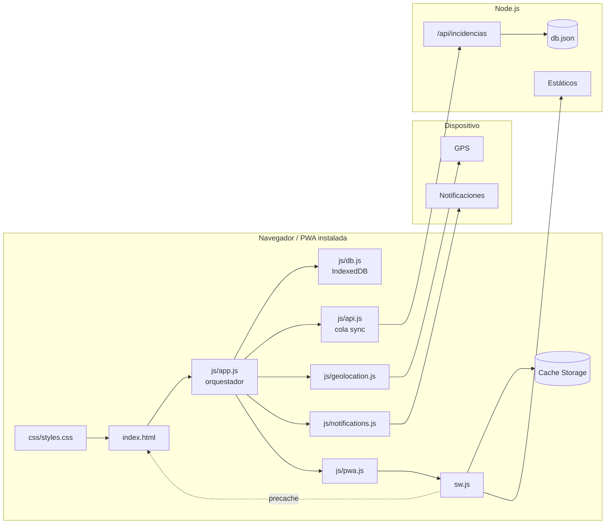
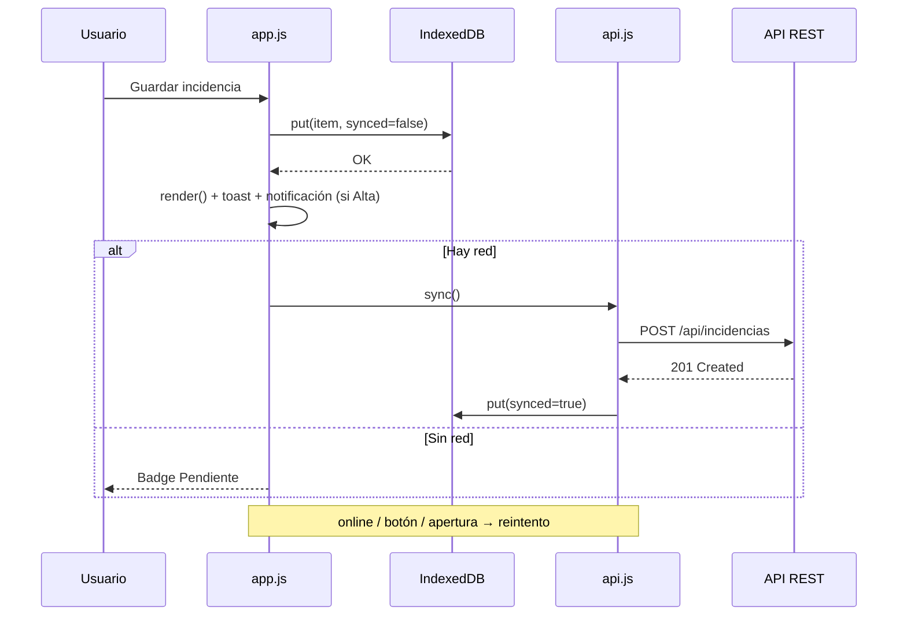
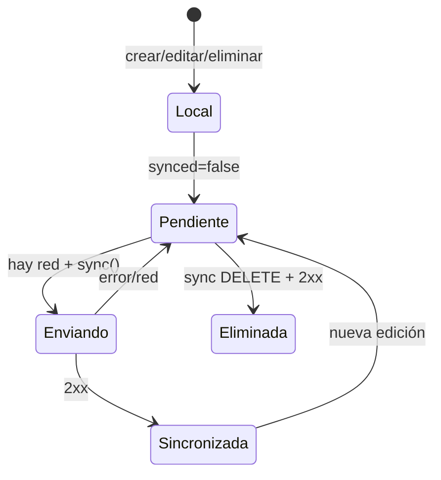

# Punto 3.5 — Documento técnico

> **Proyecto:** Alerta Campus — Registro de Incidencias (PWA)
> **Versión:** 1.0.0 · Service Worker `v5.0.1`
> **Fecha:** 24 de octubre de 2026
> **Autores:** Equipo de desarrollo Full Stack
> **Repositorio:** _(completar con la URL de GitHub)_
> **URL pública:** _(completar con la URL de despliegue)_

---

## 1. Resumen ejecutivo

«Alerta Campus» es una Progressive Web App para registrar incidencias del campus desde el
teléfono, incluso sin conexión. La aplicación sigue una arquitectura **offline-first**:
las escrituras se confirman primero en IndexedDB, la UI se actualiza de inmediato y una cola
idempotente sincroniza con una API REST cuando hay red.

La PWA incorpora:

- **Service Worker** con precache del shell y cuatro estrategias de caché diferenciadas.
- **Instalación** mediante Web App Manifest con iconos 192/512 y maskable.
- **Notificaciones locales** con `ServiceWorkerRegistration.showNotification()`.
- **Geolocalización** con manejo explícito de permisos, timeout y errores.
- **Diagnóstico interno** visible en la interfaz (SW, caché, almacenamiento, permisos).

El resultado se validó con 15 casos automatizados (100 % aprobados) y se documentó con
capturas reproducibles.

---

## 2. Introducción y objetivos

### 2.1 Problema

El reporte de incidencias ocurre en el lugar del incidente, a menudo sin cobertura. Una app
que dependa de la red pierde el reporte o fuerza al usuario a repetirlo. Además, el reporte
necesita contexto: ubicación, prioridad y un aviso de que quedó registrado.

### 2.2 Objetivos

| Objetivo | Cómo se cumple |
|---|---|
| No perder reportes por falta de red | IndexedDB + cola de sincronización. |
| Abrir rápido y siempre | Precarga del shell, Network First con fallback. |
| Avisar al usuario de un reporte crítico | Notificación local en incidencias Alta. |
| Añadir contexto físico | Geolocalización opcional. |
| Ser instalable | Manifest + iconos + HTTPS. |
| Ser mantenible | Módulos ES con responsabilidades separadas. |

### 2.3 Alcance técnico

- Frontend Vanilla JS (ES Modules), CSS y HTML.
- Backend Node.js sin dependencias (`http`, `fs`, `path`).
- Persistencia local IndexedDB; persistencia servidor `db.json`.
- Sin autenticación, sin push, sin cámara.

---

## 3. Arquitectura

### 3.1 Vista de componentes



### 3.2 Flujo de una escritura



### 3.3 Decisiones de diseño

| Decisión | Justificación |
|---|---|
| Vanilla JS con módulos | Cero dependencias, carga rápida, control del SW; el equipo ya tenía la UI. |
| IndexedDB como fuente principal | Cuota y transacciones superiores a localStorage; respaldo si falla. |
| Cola con `synced`/`updated` | Tolerante a días offline y a reintentos; sin sockets. |
| API Network Only | Evita datos obsoletos; la verdad local está en IndexedDB. |
| SW con activación manual | No interrumpe al usuario; permite avisar de la nueva versión. |
| Geolocalización opcional | Un permiso denegado no debe impedir reportar. |

---

## 4. APIs utilizadas

### 4.1 Service Worker API

**Uso:** interceptar navegación y assets, precachear, gestionar versiones, recibir mensajes y
manejar el clic de una notificación.

| Evento / método | Dónde | Función |
|---|---|---|
| `navigator.serviceWorker.register()` | `js/pwa.js` | Registra `sw.js` con scope `./`. |
| `install` | `sw.js` | Abre la caché y ejecuta `cache.addAll(PRECACHE_URLS)`. |
| `activate` | `sw.js` | Borra cachés viejas y llama `clients.claim()`. |
| `fetch` | `sw.js` | Aplica la estrategia según el tipo de recurso. |
| `message` | `sw.js` | Recibe `{type:'SKIP_WAITING'}` y activa la nueva versión. |
| `notificationclick` | `sw.js` | Enfoca/abre la app en el historial. |
| `registration.update()` | `js/pwa.js` | Busca actualizaciones cada hora y al volver a la pestaña. |
| `registration.waiting` | `js/pwa.js` | Detecta una versión instalada pendiente de activar. |

**Soporte:** Chrome/Edge/Firefox/Safari modernos. Requiere contexto seguro.

### 4.2 Cache API

**Uso:** almacenar el shell, los assets estáticos y las imágenes.

```js
const cache = await caches.open('alerta-campus-precache-v5.0.1');
await cache.addAll(PRECACHE_URLS);
const hit = await caches.match(request, { ignoreSearch: true });
```

| Caché | Contenido | Política |
|---|---|---|
| `alerta-campus-precache-v5.0.1` | Shell, CSS, JS, manifest, iconos, imágenes, offline.html | Instalación + actualización de navegación. |
| `alerta-campus-runtime-v5.0.1` | CSS/JS/JSON que se actualizan en segundo plano | SWR, sin límite explícito. |
| `alerta-campus-images-v5.0.1` | Imágenes de runtime | Cache First, máximo 70 entradas. |

**Soporte:** universal en navegadores con SW. Cuota sujeta al almacenamiento del origen.

### 4.3 Notifications API

**Uso:** pedir permiso y mostrar una notificación local desde el Service Worker.

```js
const permission = await Notification.requestPermission();
const registration = await navigator.serviceWorker.ready;
await registration.showNotification('Incidencia de prioridad Alta', {
  body: 'Fuga de agua en el laboratorio 3',
  icon: './icons/icon-192.png',
  badge: './icons/badge-72.png',
  tag: 'incidencia-<id>',
  renotify: true,
  data: { url: './index.html?action=list' },
});
```

| Aspecto | Implementación |
|---|---|
| Permiso | Solo con clic en «Activar notificaciones» o «Probar notificación». |
| Visualización | `ServiceWorkerRegistration.showNotification()` (obligatorio en Android). |
| Respaldo | `new Notification()` solo si el SW no está listo (escritorio). |
| Agrupación | `tag` por incidencia; `renotify` para reemplazar. |
| Click | `notificationclick` enfoca una ventana o abre el historial. |
| Push remoto | **No implementado** (fuera de alcance). |

**Soporte:** Chrome/Edge/Firefox en escritorio y Android; iOS 16.4+ con la PWA instalada.
Requiere contexto seguro y gesto de usuario para el permiso.

### 4.4 Geolocation API

**Uso:** obtener latitud, longitud y precisión del dispositivo.

```js
navigator.geolocation.getCurrentPosition(success, error, {
  enableHighAccuracy: true,
  timeout: 12000,
  maximumAge: 30000,
});
```

| Aspecto | Implementación |
|---|---|
| Contexto | HTTPS o localhost; si no, error `insecure`. |
| Permiso | `navigator.permissions.query({name:'geolocation'})` para el diagnóstico. |
| Timeout | 12 s nativo + temporizador de seguridad de 14 s. |
| Errores | `1` denegado, `2` no disponible, `3` timeout; mensajes accionables. |
| Precisión | Se muestra `accuracy` en metros; se guarda tal cual. |
| Mapa | Enlace a OpenStreetMap; requiere red. |
| Persistencia | `lat`, `lng`, `accuracy`, `geoAt` en IndexedDB y API. |

**Soporte:** universal; la precisión depende del hardware y del entorno. En interiores puede
fallar; la app permite guardar sin ubicación.

### 4.5 Otras APIs

| API | Uso |
|---|---|
| **IndexedDB** | Persistencia principal de incidencias y cola. |
| **localStorage** | Respaldo si IndexedDB falla o está bloqueada. |
| **Fetch API** | Comunicación con `/api/incidencias`. |
| **Permissions API** | Estado de geolocalización en el diagnóstico. |
| **Storage API** | `navigator.storage.persist()` para solicitar persistencia. |
| **Web App Manifest** | Instalación, iconos, `start_url`, `scope`, shortcuts. |
| **Page Visibility API** | Comprobar actualizaciones al volver a la pestaña. |
| **Network Information / `navigator.onLine`** | Estado de conexión y disparo de sync. |

---

## 5. Parámetros de configuración clave

### 5.1 `manifest.json`

| Campo | Valor | Por qué |
|---|---|---|
| `name` | `Alerta Campus — Registro de Incidencias` | Nombre completo en la instalación. |
| `short_name` | `Alerta Campus` | Etiqueta corta en la pantalla de inicio. |
| `description` | Texto funcional | Ficha de instalación. |
| `lang` / `dir` | `es-MX` / `ltr` | Idioma y dirección. |
| `start_url` | `./index.html` | Relativo para subcarpetas. |
| `scope` | `./` | Limita la PWA a su carpeta. |
| `display` | `standalone` | Sin barra del navegador. |
| `display_override` | `standalone`, `minimal-ui`, `browser` | Degradación progresiva. |
| `orientation` | `portrait-primary` | Experiencia móvil. |
| `background_color` | `#F4F2FB` | Fondo del splash. |
| `theme_color` | `#2A1F6B` | Barra de estado / tema. |
| `icons` | 192, 512, maskable, SVG | Instalabilidad y adaptación. |
| `shortcuts` | Nueva, Historial | Accesos rápidos. |
| `categories` | productivity, utilities, education | Clasificación. |

### 5.2 Service Worker

| Parámetro | Valor | Nota |
|---|---|---|
| `VERSION` | `v5.0.1` | Cambiar en cada release. |
| `PRECACHE` | `alerta-campus-precache-v5.0.1` | Shell. |
| `RUNTIME` | `alerta-campus-runtime-v5.0.1` | CSS/JS en segundo plano. |
| `IMAGES` | `alerta-campus-images-v5.0.1` | Imágenes. |
| `IMAGE_LIMIT` | `70` | Entradas máximas. |
| `PRECACHE_URLS` | 24 rutas | Deben existir todas. |
| Scope | `./` | Relativo a la ubicación del SW. |
| Navegación | Network First | Fallback `index.html` / `offline.html`. |
| Estáticos | Stale-While-Revalidate | Respuesta inmediata + update. |
| Imágenes | Cache First | Ahorro de datos. |
| API | Network Only | Sin caché. |
| `skipWaiting` | Solo por mensaje | El usuario decide. |

### 5.3 Notificaciones

| Parámetro | Valor |
|---|---|
| `icon` | `./icons/icon-192.png` |
| `badge` | `./icons/badge-72.png` |
| `tag` | `incidencia-<id>` o `alerta-campus-prueba` |
| `renotify` | `true` |
| `requireInteraction` | `false` |
| `lang` | `es` |
| `data.url` | `./index.html?action=list` |
| `body` máximo | 180 caracteres |
| Permiso | Solo por gesto |

### 5.4 Geolocalización

| Parámetro | Valor |
|---|---|
| `enableHighAccuracy` | `true` |
| `timeout` | `12000` ms |
| `maximumAge` | `30000` ms |
| Temporizador de seguridad | `timeout + 2000` ms |
| Decimales | 6 |
| Precisión | `Math.round(accuracy)` |
| Mapa | OpenStreetMap (`?mlat=…&mlon=…#map=18/…`) |

### 5.5 Servidor

| Variable / parámetro | Valor por defecto | Descripción |
|---|---|---|
| `PORT` | `3000` | Puerto HTTP. |
| `DB_FILE` | `./db.json` | Ruta de la base JSON. |
| `MAX_BODY` | `1 MB` | Límite del cuerpo de la API. |
| `Cache-Control` | `no-store` para HTML, SW, manifest | Evita versiones viejas. |
| `Service-Worker-Allowed` | `/` | Scope del SW en la raíz. |
| `X-Content-Type-Options` | `nosniff` | Seguridad básica. |

### 5.6 API REST

| Método | Ruta | Descripción | Respuestas |
|---|---|---|---|
| `GET` | `/api/incidencias` | Lista todas | `200 []` |
| `GET` | `/api/incidencias/:id` | Obtiene una | `200`, `404` |
| `POST` | `/api/incidencias` | Crea (idempotente por `id`) | `201`, `200` |
| `PUT` | `/api/incidencias/:id` | Actualiza si `updated` es mayor o igual | `200` |
| `DELETE` | `/api/incidencias/:id` | Elimina (idempotente) | `200` |
| `GET` | `/api/health` | Estado del servicio | `200` |

Validaciones del servidor:

- `id` no vacío (máx. 100 caracteres).
- `titulo` no vacío (máx. 120).
- `prioridad` en `Baja | Media | Alta`.
- `descripcion` máx. 1000.
- `lat` en `[-90, 90]`, `lng` en `[-180, 180]`.
- Fechas ISO válidas o se usa la actual.
- `updated` decide el conflicto (last-write-wins).

---

## 6. Modelo de datos y sincronización

### 6.1 Entidad `Incidencia`

| Campo | Tipo | Obligatorio | Descripción |
|---|---|---|---|
| `id` | string (UUID) | Sí | Generado en el cliente; clave primaria. |
| `titulo` | string | Sí | Resumen de la incidencia. |
| `prioridad` | enum | Sí | `Baja`, `Media`, `Alta`. |
| `descripcion` | string | No | Detalle. |
| `fecha` | ISO string | Sí | Creación. |
| `updated` | ISO string | Sí | Última modificación; resuelve conflictos. |
| `synced` | boolean | Sí | `true` si el servidor confirmó. |
| `onServer` | boolean | No | `true` si ya existe en el servidor. |
| `deleted` | boolean | No | Borrado lógico. |
| `lat` / `lng` | number | No | Coordenadas. |
| `accuracy` | number \| null | No | Precisión en metros. |
| `geoAt` | ISO string \| null | No | Momento de la captura. |

### 6.2 Máquina de estados de sincronización



### 6.3 Resolución de conflictos

- Cada cambio actualiza `updated` a la hora actual.
- El servidor solo reemplaza si `clean.updated >= existente.updated`.
- El cliente no marca `synced` si el registro cambió mientras se enviaba
  (`current.updated !== item.updated`), para no perder la edición.
- La descarga remota solo aplica si el registro local está sincronizado, no borrado y el
  remoto es más nuevo.
- Esto es **last-write-wins**, suficiente para un equipo pequeño; no hay merge de campos.

### 6.4 Idempotencia

- El `id` se genera en el cliente antes del primer envío.
- Un reintento con el mismo `id` actualiza (no duplica).
- `DELETE` es idempotente: si no existe, responde `200`.
- El arnés CP-11 verificó dos POST con el mismo `id` → una sola copia.

---

## 7. Seguridad y privacidad

| Tema | Medida actual | Recomendación |
|---|---|---|
| Transporte | HTTPS/localhost obligatorio para SW y GPS. | Forzar HSTS y redirección HTTPS. |
| XSS | `esc()` en títulos, descripciones e IDs antes de insertar HTML. | Añadir CSP estricta (requiere ajustar estilos inline). |
| API | Validación de tipos y longitudes; `nosniff`. | Añadir autenticación JWT/sesión y rate limiting. |
| Datos | `db.json` sin cifrar. | Cifrar en reposo y usar base de datos con backups. |
| Ubicación | Solo por acción del usuario; se puede quitar. | Política de privacidad y retención. |
| Permisos | Sin solicitudes automáticas. | Mantener el patrón de gesto explícito. |
| Dependencias | Cero dependencias de producción. | Auditar si se añaden. |
| Secretos | No hay claves en el frontend. | Usar variables de entorno en el servidor. |

**Riesgo principal:** la API no tiene autenticación. No debe usarse con datos personales
reales hasta añadir autenticación, autorización por rol y auditoría.

---

## 8. Rendimiento y accesibilidad

### 8.1 Rendimiento

- Shell de ~50 KB de HTML/CSS/JS (sin imágenes); carga rápida en 3G.
- Precarga de 24 recursos; las imágenes se sirven desde caché.
- Render con `innerHTML` de listas pequeñas; suficiente para cientos de incidencias.
- `staleWhileRevalidate` evita bloquear la UI por la red.
- No se cargan fuentes externas ni frameworks.

### 8.2 Accesibilidad

- `lang="es"` y estructura semántica (`header`, `section`, `nav`, `article`).
- `aria-live="polite"` en estado de red, ubicación y avisos.
- `role="dialog"` + `aria-modal="true"` en el diálogo de borrado.
- `:focus-visible` visible.
- Etiquetas asociadas a campos.
- Botones con texto e iconos decorativos.
- `prefers-reduced-motion` respetado.
- Contraste alto en la paleta principal.

---

## 9. Pruebas y resultados

| Aspecto | Resultado |
|---|---|
| Casos automatizados | 15/15 aprobados. |
| Service Worker | Activo y controlando la página. |
| Caché | 24–34 recursos; 1–2 cachés según navegación. |
| Offline | Recarga y CRUD funcionando. |
| Sincronización | Cola enviada al reconectar; idempotente. |
| Notificaciones | Permiso y payload verificados con `getNotifications()`. |
| Geolocalización | Éxito, denegación y timeout cubiertos. |
| Manifest | Sin errores de instalabilidad. |
| Consola | Sin excepciones. |

El detalle está en [05-reporte-pruebas.md](05-reporte-pruebas.md) y el reporte crudo en
[`tests/results/report.json`](../tests/results/report.json).

---

## 10. Conclusiones técnicas

1. **El enfoque offline-first es adecuado para el problema.** La app nunca bloquea el
   reporte por falta de red; la sincronización es eventual y tolerante a fallos.
2. **La separación en módulos facilita el mantenimiento.** El SW no conoce la UI y la UI no
   conoce IndexedDB; cada capa tiene una responsabilidad clara.
3. **Las estrategias de caché deben ser heterogéneas.** Un único Network First (como en la
   versión inicial) no garantiza el arranque offline; un único Cache First serviría datos
   obsoletos. La combinación por tipo de recurso es la decisión correcta.
4. **La actualización del SW es un tema de UX, no solo técnico.** Avisar y dejar decidir
   evita recargas que interrumpen la captura de una incidencia.
5. **La geolocalización es valiosa pero debe ser opcional.** Un permiso denegado o un
   interior sin GPS no pueden impedir el reporte; el diseño de estados lo resuelve.
6. **La evidencia debe ser reproducible.** El arnés E2E con CDP permite regenerar capturas
   y resultados, reduciendo el trabajo manual y las inconsistencias.

---

## 11. Limitaciones y trabajo futuro

### 11.1 Limitaciones actuales

- Sin autenticación ni roles.
- Sin notificaciones push (solo locales).
- Sin cámara/fotografía.
- Sin geocodificación inversa (dirección textual).
- `db.json` no es una base de datos concurrente; para producción se necesita PostgreSQL/
  SQLite con backups.
- El plan gratuito de Render suspende el servicio y pierde `db.json` en cada redeploy.
- En hosting estático no hay API; la sincronización queda pendiente.
- No hay Background Sync API (decisión de compatibilidad).
- Las pruebas en iOS real y con lectores de pantalla están pendientes.

### 11.2 Trabajo futuro

| Mejora | Valor |
|---|---|
| Autenticación + roles | Seguridad y trazabilidad. |
| Web Push + VAPID | Avisos con la app cerrada. |
| Cámara + compresión de imagen | Evidencia visual. |
| Geocodificación inversa | Dirección legible. |
| Base de datos real (Postgres/SQLite) | Concurrencia y backups. |
| Panel administrativo | Gestión y asignación de incidencias. |
| Tests unitarios de módulos | Cobertura rápida en CI. |
| Accesibilidad auditada (WCAG 2.2 AA) | Inclusión. |
| Internacionalización | Otros idiomas. |
| Background Sync | Reintento incluso con la app cerrada. |

---

## 12. Referencias

- [MDN — Service Worker API](https://developer.mozilla.org/es/docs/Web/API/Service_Worker_API)
- [MDN — Cache API](https://developer.mozilla.org/es/docs/Web/API/Cache)
- [MDN — Notifications API](https://developer.mozilla.org/es/docs/Web/API/Notifications_API)
- [MDN — Geolocation API](https://developer.mozilla.org/es/docs/Web/API/Geolocation_API)
- [MDN — Web App Manifest](https://developer.mozilla.org/es/docs/Web/Manifest)
- [web.dev — Service Worker caching strategies](https://web.dev/articles/service-worker-caching-and-http-caching)
- [web.dev — Offline cookbook](https://web.dev/articles/offline-cookbook)
- [W3C — Service Workers](https://www.w3.org/TR/service-workers/)
- [Chrome DevTools Protocol](https://chromedevtools.github.io/devtools-protocol/)
- [OpenStreetMap](https://www.openstreetmap.org/)

---

## 13. Anexos

### A. Estructura del repositorio

Ver [01-planeacion.md §6.4](01-planeacion.md#64-estructura-de-archivos).

### B. Comandos útiles

```powershell
node server.js                 # Servidor local
node tests/e2e.mjs             # Pruebas y evidencias
python tools/generate-icons.py # Regenerar iconos (Pillow)
```

### C. Glosario

| Término | Definición |
|---|---|
| **PWA** | Progressive Web App: app web instalable con capacidades nativas. |
| **Service Worker** | Proxy programable entre la app y la red; habilita offline y caché. |
| **Precache** | Carga anticipada de recursos durante la instalación del SW. |
| **SWR** | Stale-While-Revalidate: sirve caché y actualiza en segundo plano. |
| **Offline-first** | La app funciona sin red; la red es una mejora. |
| **Idempotencia** | Repetir una operación no cambia el resultado. |
| **Last-write-wins** | Gana la escritura con la marca de tiempo más reciente. |
| **Maskable icon** | Icono con zona segura para recortes del sistema. |

